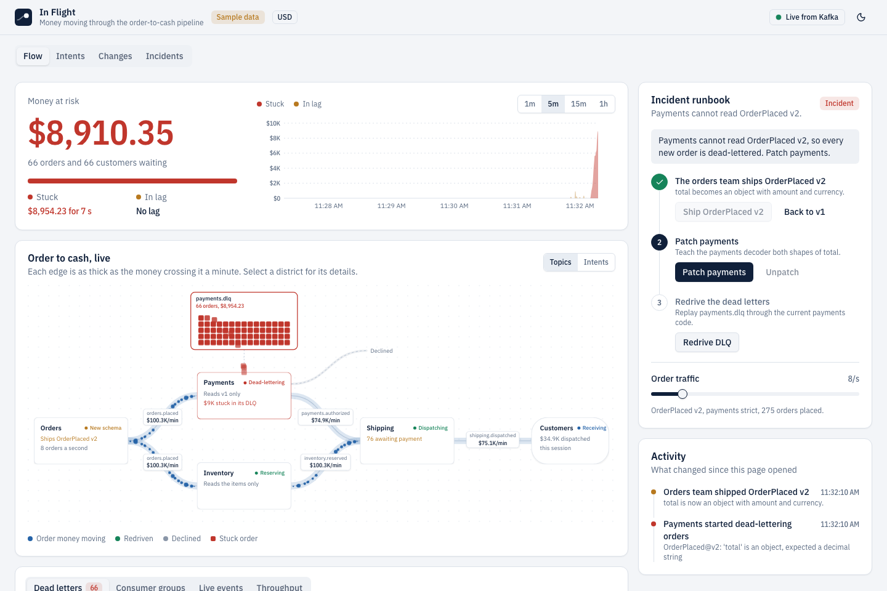
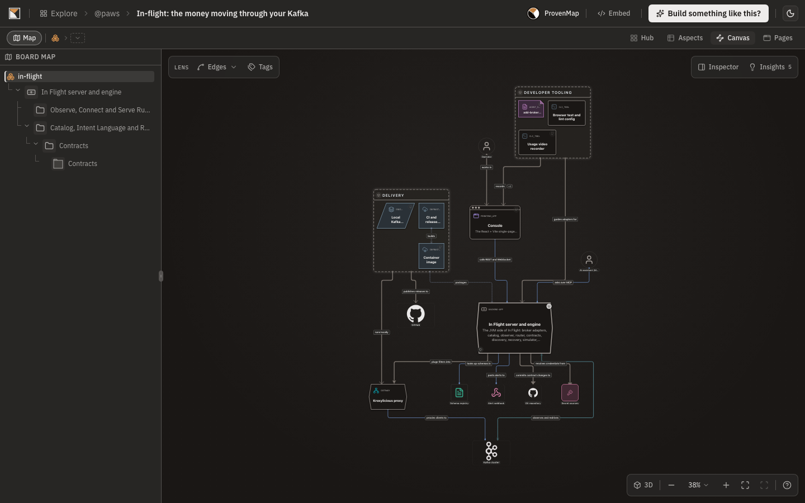

# In Flight

A console and an MCP server for the money moving through your Kafka. Point it at a cluster; it finds the flow; you
confirm what the money is; it shows what is stuck, for whom, worth how much, and lets you recover it. Shipping schema
changes safely comes after that, for teams that want it.

**Money is the default, not the limit.** A flow can count anything its events carry: parcels, kilograms, claims,
GPU-hours, or simply how many events are held up. The headline, the map, the alerts, the redrive reports and the MCP
answers all follow, in your unit and your words ("Parcels at risk: 40 parcels, 12 shipments and 9 recipients
waiting"). See
[Not only money](#not-only-money).

**Watch it in under two minutes:** connecting to a shop's Kafka, finding its flow, confirming what the money is, then
a failing service, the money stuck, and getting it moving again. No voice; callouts on screen.

<!-- usage video: drag docs/usage.mp4 here in the GitHub editor; GitHub turns the link it inserts into a player -->

**See how it is built:** its architecture is a
[public board on ProvenMap](https://provenmap.com/boards/paws/in-flight-the-money-moving-through-your-kafka?view=canvas),
every component and what it talks to. Open it and drill in; no account needed.

```
  connect ──────────▶ discover ──────────▶ confirm ──────────▶ watch ──────────▶ act
  a cluster, its      topics, consumer       what it's worth,     what is stuck,     redrive a queue,
  registry, tested    groups, dead-letter    the order and        for whom, worth    alert, ship a
                      queues, field shapes   customer, the teams  how much           change safely
```



## Watch your own Kafka

```sh
docker run --rm -p 8088:8088 -v ~/.in-flight:/home/in-flight/.in-flight in-flight  # or, from a checkout:
bin/in-flight                                                                # starts the app and opens http://localhost:8088
```

With nothing configured, the console opens on **Connect**:

1. **Connect.** Bootstrap servers, an auth preset (none, TLS, SASL/PLAIN for Confluent Cloud, SCRAM, mutual TLS, MSK
   IAM), and where each secret is: an environment variable, a file, or the macOS keychain (`env:KAFKA_PASSWORD`,
   `file:/run/secrets/kafka`, `keychain:kafka-staging`). Secrets are never typed in or stored, only where they are.
   Add the schema registry if your topics are Avro. Test, then save it as a profile.
2. **Discover.** Every topic and how much is on it, every consumer group and what it reads, which topics are
   dead-letter queues (by name, or by Kafka Connect's, Spring's or this tool's headers on their records) and which
   group writes each. Pick the topics of one flow; click one to see its fields, values masked.
3. **Confirm.** A catalog is drafted from what the records show: which field is the money (and whether it is in
   cents), or that the flow is not money and its events are counted; which the order and the customer; which team
   owns what. Every guess comes with how sure it is and a
   question; answer them on one screen, see what each event would be worth on the sampled records, and activate.
4. **Watch.** Money at risk (or parcels, shipments: whatever the flow counts), stuck and in lag, by team and consumer group; every stuck event with its customer, order
   and the error that stopped it, grouped by cause; lag from before the console started valued at each topic's recent
   average, marked as an estimate. The chart, the episodes and recovery times survive a restart.
5. **Act.** Redrive a dead-letter queue back to where each letter came from, filtered by error, order or time, after
   a dry run, rate-limited, and only on a profile you have allowed to write. A webhook when money at risk crosses a
   threshold (`PUT /api/alerts`).

The catalog is a plain file (`~/.in-flight/flows/<flow>.json`) to keep in a repository, and to edit by hand
when you want to. It never needs writing from scratch.

The observer only reads: it never joins or commits for your groups. It reads CloudEvents (structured or binary),
plain JSON, JSON framed for a schema registry, and Avro and Protobuf through a Confluent or Apicurio registry.

## Not only money

Underneath, the tool tracks *something in flight* (a case), *who waits on it* (a party) and *what it is worth* (a
measure). Money, orders and customers are the default; four optional keys in the catalog change them:

| Key | What it does | Example |
| --- | --- | --- |
| `unit` | what the worth is counted in, shown after every number, instead of a currency | `"parcels"`, `"kg"`, `"GPU-hours"` |
| `measureName` | what the headline calls it; the unit, capitalised, when left out | `"Weight"` for "Weight at risk" |
| `count` | every event is worth one (of the unit, or "events"), whatever its fields say: for events with no amount | `true` |
| `nouns` | what one case and one party are called; else the `roles` names, else order and customer | `{ "case": "shipment", "party": "recipient" }` |

```json
{
  "flow": "deliveries",
  "unit": "parcels",
  "nouns": { "case": "shipment", "party": "recipient" },
  "events": [
    { "type": "ShipmentBooked", "version": 1, "topic": "shipments", "district": "depot",
      "value": "parcel_count", "customer": "recipientId", "order": "shipmentId" }
  ]
}
```

Some flows it fits:

| Flow | Case | Party | Worth |
| --- | --- | --- | --- |
| Logistics | shipment | recipient | parcels, or kg |
| Insurance | claim | policyholder | the amount claimed (money) |
| Healthcare | lab order | patient | a count |
| Compute | job | team | GPU-hours |
| Data pipelines | batch | downstream team | rows |
| IoT | command | site | a count, or devices affected |

How to set it:

- **On Confirm:** when the records name no currency, the currency question has a fourth answer, *Not money: count the
  events*. A unit of your own (`parcels`) is set with **Edit JSON** on the same screen.
- **By asking an agent:** "the shipments flow counts parcels, not money": `edit_catalog` takes a JSON Patch such as
  `[{"op": "remove", "path": "/currency"}, {"op": "add", "path": "/unit", "value": "parcels"}]`.
- **By hand:** the catalog file, then `in-flight activate <flow> <file>`.

A catalog gives a `currency` or a `unit`, never both. Value paths and the `roles` measure work the same whatever the
unit is; `minorUnits` and `rates` are about money only.

It was called revenue-in-flight until 2026-11-14, when it stopped being only about money. Settings from then still
work: `RIF_` variables are read when their `INFLIGHT_` names are not set, and a `~/.revenue-in-flight` workspace is used
when there is no `~/.in-flight`.

### Set it up by asking

```sh
claude mcp add in-flight -- in-flight mcp            # stdio; also serves the console on :8088
```

Then, in Claude Code or any MCP client: "connect to our staging Kafka and watch the checkout flow". The
`set-up-a-flow` prompt walks an agent through `status`, `connect`, `discover`, `sample_topic`, `draft_catalog`,
`validate_catalog`, `edit_catalog` and `activate`; where the client supports it, the draft's questions are asked
directly. `connect` takes secret references only and refuses a secret typed into the chat.

| Tool | Does | Writes |
| --- | --- | --- |
| `status` | what is connected, which flow is active, whether it is healthy, what is missing, what to do next | no |
| `connect` | tests a connection (bootstrap servers, an auth preset, a schema registry) and saves it as a profile | config only |
| `discover` | topics, partitions, consumer groups and what each reads, dead-letter queue candidates and why, registry subjects | no |
| `sample_topic` | the field shapes of a topic's recent records, decoded through the registry; values masked unless `reveal` | no |
| `draft_catalog` | a catalog from what was discovered, with a confidence and a question for every guess | config only |
| `validate_catalog` | checks a catalog, then dry-runs it on sampled records: does each path resolve, what would each event be worth | no |
| `edit_catalog` | a JSON Patch to the draft or the active catalog, or an answer to one of the draft's questions | config only |
| `activate` | saves a catalog and switches the running observer to it, no restart | config only |
| `value_at_risk`, `stuck_events`, `last_episode` | the value held up (money, or what the catalog counts), stuck and in lag; what is stuck and why, by cause; the latest recovery | no |
| `redrive` | replays dead letters to their source topic, filtered, dry run first | **the cluster**, opt-in per profile |
| `intents`, `explain_intent`, `impact`, `tail_intent`, `change_status` | what the catalog means, and changes to it | no |

The resource `in-flight://flow` describes the flow being watched. Every tool is also an HTTP endpoint and a console screen
(see `server/src/main/java/inflight/server/Api.java`), so nothing is agent-only. Streamable HTTP is served on
`http://localhost:8088/mcp`; beyond localhost it needs `INFLIGHT_MCP_TOKEN`.

### From a script or CI

```sh
in-flight connect staging kafka-1:9092,kafka-2:9092 --auth scram-sha-512 \
    --secret username=alice --secret password=env:KAFKA_PASSWORD --registry http://registry:8081
in-flight discover
in-flight sample checkout.orders
in-flight draft checkout checkout.orders checkout.payments
in-flight validate checkout                          # exits 1 when the catalog does not price what was sampled
in-flight activate checkout
in-flight redrive payments.dlq --error timeout       # a dry run; --run to do it
in-flight impact OrderPlaced@v2 flows/checkout.json  # exits 1 when a consumer must change first
```

Everything lives in `~/.in-flight` (or `--home`, or `INFLIGHT_HOME`): `config.json` holds the connection profiles
(with secret references, never secrets), the active flow, and alerts; `flows/` the catalogs; `state/` the ledger's
snapshots. Bound beyond localhost (`HOST=0.0.0.0`), the console asks for a login token: `INFLIGHT_TOKEN`, or one printed at
start.

## Try it with sample data

`in-flight try` runs a simulated order-to-cash business, clearly labelled as sample data: Orders, Payments,
Inventory and Shipping as districts on a flow map, each edge as thick as the money crossing it a minute. It makes one
schema change, `OrderPlaced` v2, twice:

1. **Around the catalog.** The orders team writes v2 straight to Kafka. Payments cannot read it and dead-letters
   every order, money at risk climbs, Payments is patched, the dead-letter queue is redriven, the counter drains.
2. **Through the catalog.** The same change is proposed. The console shows Payments must change and Inventory need
   not, with Payments' regenerated binding as a migration. The schema gate refuses v2 until that migration merges and
   the change is approved. Then v2 ships, and nothing gets stuck.

You need Docker and a JDK 25 (Node 22 only to build the console):

```sh
npm ci && npm run build  # the console, which the jar carries
./mvnw package           # one jar: cli/target/in-flight.jar
bin/in-flight up         # Kafka 4.4, the Apicurio registry, the Kroxylicious proxy with our filters
bin/in-flight try        # in a second shell: router, simulator and console; open http://localhost:8088
```

Nothing on screen is canned: real Kafka services with real consumer groups, reading through a real proxy; the router
is a Kafka Streams application per intent; the gate is a Kroxylicious filter checking a schema registry. The console
has four views over the same flow map:

| View | Answers |
| --- | --- |
| **Flow** | what is moving, what is stuck, what it is worth; edges labelled by topic or by the intent their reader subscribes to |
| **Intents** | who cares about what. Type a predicate and it compiles as you type: its matches light up on the map |
| **Changes** | what a schema change will do, who must change first and why, each migration's binding as a diff, and whether the gate lets it through |
| **Incidents** | the runbook, what is stuck grouped by cause, and every stuck event |

For the first run, ship `OrderPlaced` v2 from the runbook, then patch and redrive. For the second, open Changes:
propose, switch the orders team to ship through the gate, ship v2 (the gate refuses it, so orders keep going out as
v1), merge Payments' migration, approve, and watch v2 flow with nothing stuck. [The guide](docs/guide.md) walks
through it with screenshots. `up kafka`, then `simulate` and `serve`, runs the incident alone on Kafka.

## Going further: meaning, intents and the gate

Each step is useful without the next, and none needs a higher one:

| Level | You add | You get | Touches your cluster |
| --- | --- | --- | --- |
| 0. Watch | a catalog, drafted for you: topics, consumer groups, dead-letter queues, where the value is (money, a count or a unit of your own) | what is stuck and lagging, in your own terms | reads only (a redrive writes, when you allow it) |
| 1. Meaning | entities, fields, keys, effects, intents | `impact` on every proposed event version, in CI | not at all |
| 2. Subscribe | the router | consumers read `intent.<name>`, ordered per entity | writes derived topics |
| 3. Gate | the proxy in front of producers | an undeclared event shape cannot be produced | in the produce path |

A catalog with `roles` (`case`, `party`, `measure`) needs no value paths: an event's order and customer come from its
keys, and its worth from its effect on the measure. A value in cents says `"minorUnits": true`; an event in another
currency says `"currency"` or `"currencyField"`, converted at the catalog's `"rates"`. A worth that cannot be
established is shown as unknown, never guessed. [The guide](docs/guide.md#watch-your-own-kafka) has the format.

## Ask before you break anything

`impact` reads the catalog only, so it needs no Kafka:

```sh
bin/in-flight impact OrderPlaced@v2
```

```
payments-service must change before this ships, or its events pile up in payments.dlq.
  ...
  - order-total-changes: changes(Order.total)
      ! OrderPlaced@v2 from orders.placed, read differently from OrderPlaced@v1:
          Order.total: from total (decimal) -> from total.amount (decimal)
      consumers: payments-service
  - orders-placed: emits(OrderPlaced)
      + OrderPlaced@v2 from orders.placed, read the same way as OrderPlaced@v1
      consumers: inventory-service
```

It exits 1 when a consumer must change first, so it can gate a pull request that adds a version to the catalog.

## Read by intent, not by topic

Kafka expects every consumer to know which topics hold what it needs, and which fields to read from each version of
each event. The catalog carries that knowledge instead. It says what each event means: the entities it is about, and
what it does to their attributes.

```json
"entities": { "Order": { "total": "decimal", "status": "string" }, "Customer": {} },
"events": [{
  "type": "OrderPlaced", "version": 2, "topic": "orders.placed", "district": "orders",
  "fields": { "orderId": "string", "customerId": "string", "total": { "amount": "decimal", "currency": "string" } },
  "keys": { "Order": "orderId", "Customer": "customerId" },
  "effects": [{ "op": "assign", "attribute": "Order.total", "from": "total.amount" }]
}],
"intents": [{ "name": "order-total-changes", "predicate": "changes(Order.total)" }],
"consumers": [{ "group": "payments-service", "district": "payments", "intent": "order-total-changes", "dlq": "payments.dlq" }]
```

| Predicate | Means |
| --- | --- |
| `changes(Order.total)` | every event version with an effect on that attribute, from whichever topics |
| `emits(OrderPlaced)` | every version of that event type |
| `about(Order)` | every event that carries that entity's key |
| `and`, `or`, `not`, `( )` | combine them; `not` binds tightest, then `and`, then `or` |

An intent is compiled when the catalog loads. It fails on an entity, attribute or event type the catalog does not
have; nothing is matched by guessing. The **router** then makes each intent a real topic: one Kafka Streams
application per intent reads the topics its matches come from and writes `__intent.<name>`, keyed by the intent's
entity, in order per entity. A consumer subscribes with a stock Kafka client to `intent.<name>` through the
**proxy**, which renames it both ways and refuses writes to it.

- **Order:** per entity, by event time, within the grace window (`GRACE_MS`, 1.5 s). A later event older than one
  already released is delivered at once and marked `ib-late`; nothing is dropped.
- **Delivery:** at least once by default, exactly once with `PROCESSING_GUARANTEE=exactly_once_v2`.
- **Provenance:** every event carries `ib-intent`, `ib-catalog-revision`, `ib-entity`, `ib-source-topic`,
  `ib-source-partition` and `ib-source-offset`.
- **An intent declared at runtime** sees the events that already exist: each intent is its own application, reading
  from the start.
- **A version the active catalog does not know** was produced around the gate. It goes to the intents that route its
  type, so its readers meet it and dead-letter it where it can be seen and recovered, instead of losing the order.

```sh
bin/in-flight intents  # each intent: what it matches, why, who reads by it
bin/in-flight explain "changes(Order.payment)" # try a predicate without declaring it
bin/in-flight router   # the router alone, control API on 8085
```

## Changes, and the gate

A proposal is the catalog's next revision. `contracts propose` works out its impact, checks each new version against
the schema registry, and for each consumer that must change, regenerates its typed binding (Java: a record per event
version, decoded from the CloudEvent, with its typed effects on the intent's entity) on a branch, or as a pull request
with `--push`. The **schema gate** in the proxy refuses to produce any version the registry does not have, so the new
version cannot be produced until `contracts approve` finds every migration merged, registers it, and activates the
revision on the router.

```sh
bin/in-flight contracts propose catalog/order-to-cash.json
bin/in-flight contracts status rev2
bin/in-flight contracts approve rev2       # held until every migration has merged
```

The gate binds only producers that write through the proxy: keep producers behind it, as network policy. The
registry holds approved shapes and carries no compatibility rule of its own: whether a change is compatible is the
catalog's to judge, from who reads which field.

## Rehearse a build on the past

Name an intent, a time range and a build: the intent's past events run through that build beside the one running
now, the candidate's output goes to a branch topic no reader sees, and the difference comes back.

```sh
bin/in-flight rehearse order-total-changes patched 30
```

```
Rehearsed 312 events of intent.order-total-changes through payments-service: strict {PaymentAuthorized=196,
dead-lettered=105, PaymentDeclined=11}, patched {PaymentAuthorized=289, PaymentDeclined=23}. They disagree on 105
events. The candidate's output is on rehearse.r3f9a1c02.payments-service.
```

The figures are illustrative; the wording is what it prints. The simulator has the code of Payments only, as `strict`
(OrderPlaced v1) and `patched` (its regenerated binding).

## How it works

Java 25 for the backend, one Maven build; TypeScript and React for the console.

[](https://provenmap.com/boards/paws/in-flight-the-money-moving-through-your-kafka?view=canvas)

The [public board](https://provenmap.com/boards/paws/in-flight-the-money-moving-through-your-kafka?view=canvas) draws
the server and engine, the console, delivery and the systems they talk to; drill into the engine for its modules.

| Module | What it is |
| --- | --- |
| `catalog` | the file format and its checks, the intent language and compiler, impact, pricing. Pure: no Kafka. The shipped flow is `catalog/order-to-cash.json` |
| `router` | Kafka Streams: one application per intent, a derived topic keyed by entity, ordered per entity; control API on 8085 |
| `proxy-filter` | the Kroxylicious filters: the `intent.<name>` alias and the schema gate |
| `contracts` | registry check, binding generation, migration branches and pull requests, approval |
| `broker` | the broker adapter interface (streams, shards, offsets, groups, cursors, capabilities), connection profiles and secret references. No client library |
| `codec` | the decoders (JSON, CloudEvents, Avro, Protobuf) and the schema registry client, for whatever broker carried the bytes |
| `kafka` | the Kafka adapter: Kafka and everything that speaks its protocol, behind `broker`; and the client helpers the simulator and the tests share |
| `discovery` | topics, groups and dead-letter queues; sampling and field shapes; drafting a catalog with its questions; the dry run |
| `recovery` | a redrive for any dead-letter queue: filtered, rate-limited, dry run first |
| `observer` | the ledger (stuck, lag, recovered, kept across restarts), the reader and the poller; it learns intent topics and per-intent lag |
| `simulator` | the sample data: order-to-cash services, reading by intent through the proxy when there is one; both ways of shipping v2; rehearsal |
| `server` | the workspace, the engine that swaps the observer, setup and recovery actions, HTTP, WebSocket, MCP, alerts, the console |
| `cli` | one entry point for every command, and the runnable jar |
| `ui/` | React, shadcn/ui and D3: the flow map, money at risk over time, the four views |

`observer`, `discovery`, `recovery`, `server`, `codec` and `broker` never touch a Kafka client: they reach the broker through
`inflight.broker`, and the build fails if a Kafka library creeps onto their class path. `router`, `proxy-filter` and
`simulator` are Kafka-only by nature.

Money at risk (or whatever the catalog counts instead) is what is stuck plus what is in consumer lag, each case counted
once at the most it is worth anywhere it is held up. A redrive is one pass over the dead-letter queue in its own consumer group; the first record that still
fails stops its partition without moving its offset. [docs/PLAN.md](docs/PLAN.md) has the design.

## Other brokers

Anything that speaks Kafka's protocol works today with the Kafka adapter: Redpanda, WarpStream, Amazon MSK, Confluent
Cloud, Aiven, Azure Event Hubs' Kafka endpoint, Pulsar with its Kafka protocol handler.

For a broker that does not, the observer, discovery and redrive work through a small adapter interface
(`broker/src/main/java/inflight/broker`), and an adapter is a module of its own found at run time. A profile names its
adapter (`"broker": "pulsar"`, or `connect --broker pulsar`). Not every broker can be watched: the observer must be
able to read without taking messages from the services that need them, which a classic queue (RabbitMQ, SQS) does
not allow. To write one, ask Claude Code to "add a broker adapter for &lt;broker&gt;": the
[`add-broker` skill](.claude/skills/add-broker/SKILL.md) walks through deciding what the broker can do, mapping its
concepts, and testing the adapter. The interface is experimental until a second adapter has shaped it.

## Configuration

| Variable | Default | |
| --- | --- | --- |
| `INFLIGHT_HOME` | `~/.in-flight` | the workspace: profiles, flows, state |
| `INFLIGHT_TOKEN` | made up and printed | the console's login token, when `HOST` is not localhost |
| `BOOTSTRAP_SERVERS` | `localhost:9092` | Kafka, for `try`, `watch` and the sample data's commands |
| `INFLIGHT_BROKER` | `kafka` | which broker adapter `watch` and `rehearse` use when no profile says |
| `PORT`, `CONTROL_PORT`, `ROUTER_PORT` | `8088`, `8090`, `8085` | the console, the simulator, the router |
| `SIMULATOR_URL` | `http://localhost:8090` | where `serve` finds the simulator; set, `mcp` serves the sample data |
| `INFLIGHT_INTENTS_VIA` | none | the proxy, for `simulate`: its services then read by intent through it |
| `INFLIGHT_PROXY`, `APICURIO_URL`, `ROUTER_URL` | `localhost:9192`, `http://localhost:8080/apis/registry/v3`, `http://localhost:8085` | the proxy, the registry and the router, for `demo` and `contracts` |
| `INFLIGHT_CATALOG` | the shipped one | the sample data's catalog file |
| `INFLIGHT_KAFKA_*` | none | Java client settings: `INFLIGHT_KAFKA_SECURITY_PROTOCOL=SASL_SSL` sets `security.protocol` |
| `HOST` | `localhost` | the interface servers listen on |
| `INFLIGHT_MCP_TOKEN` | none | a bearer token for MCP over HTTP; required when `HOST` is not localhost |
| `GRACE_MS`, `PROCESSING_GUARANTEE`, `STATE_DIR` | `1500`, `at_least_once`, a temporary folder | the router |

## Docker

```sh
docker build -t in-flight .
docker run --rm -p 8088:8088 -v ~/.in-flight:/home/in-flight/.in-flight in-flight
docker run --rm --network host in-flight try          # the sample data, on the stack `up` starts
```

The image listens on all interfaces, so the console asks for its login token (printed at start, or `INFLIGHT_TOKEN`) and
MCP over HTTP stays off until `INFLIGHT_MCP_TOKEN` is set. Secret references by `env:` need the variable passed with
`-e`; by `file:`, the file mounted.

## Develop

```sh
./mvnw verify             # every module's unit tests
./mvnw verify -Pe2e       # end to end, on Kafka, the registry and the proxy in containers (needs Docker)
npm run lint && npm run typecheck
npm run dev:ui            # the console with hot reload, against serve on 8088
npm run test:browser      # Playwright against the jar and the Kafka in BOOTSTRAP_SERVERS
npm run docs:screenshots  # retakes the guide's sample-data screenshots
test/setup/seed.sh && npx playwright test -c playwright.setup.config.ts && test/setup/seed.sh down
                               # the setup flow in a browser, against a throwaway Kafka; retakes its screenshots
packaging/jpackage.sh     # a self-contained download for this machine, in dist/release
```

The end-to-end suites each start their own Kafka (or whole stack) in containers. `ProductIT` is the product's own:
an agent takes a running instance from no config to a watched flow of a sample application with Avro on one topic,
moves it to another cluster and back, breaks the application's consumer, restarts in the middle, and redrives. The browser tests start their own
simulator, which refuses to share a Kafka with another one: stop the demo first, or point `BOOTSTRAP_SERVERS` at
another Kafka.

## License

Apache 2.0. See [LICENSE](LICENSE).

Apache Kafka, Kafka and Apache are trademarks of the [Apache Software Foundation](https://www.apache.org/). In Flight
works with Apache Kafka and is not affiliated with or endorsed by the ASF.
