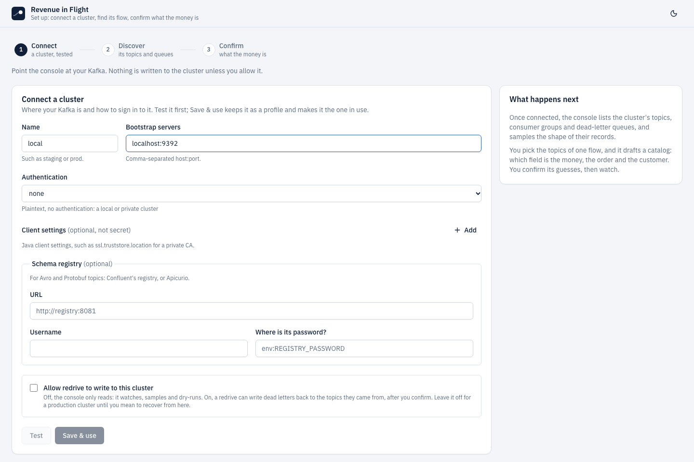
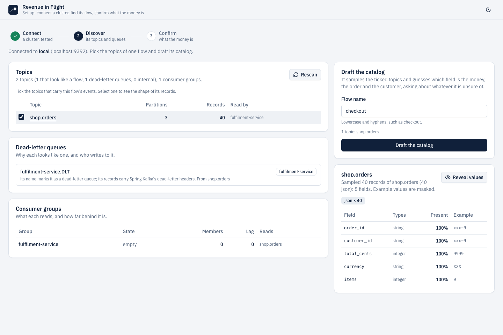
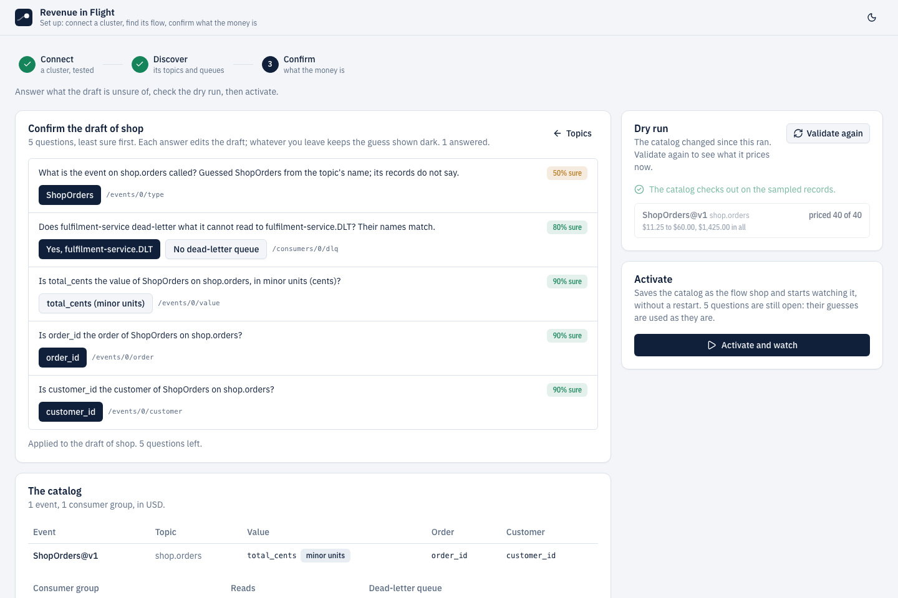
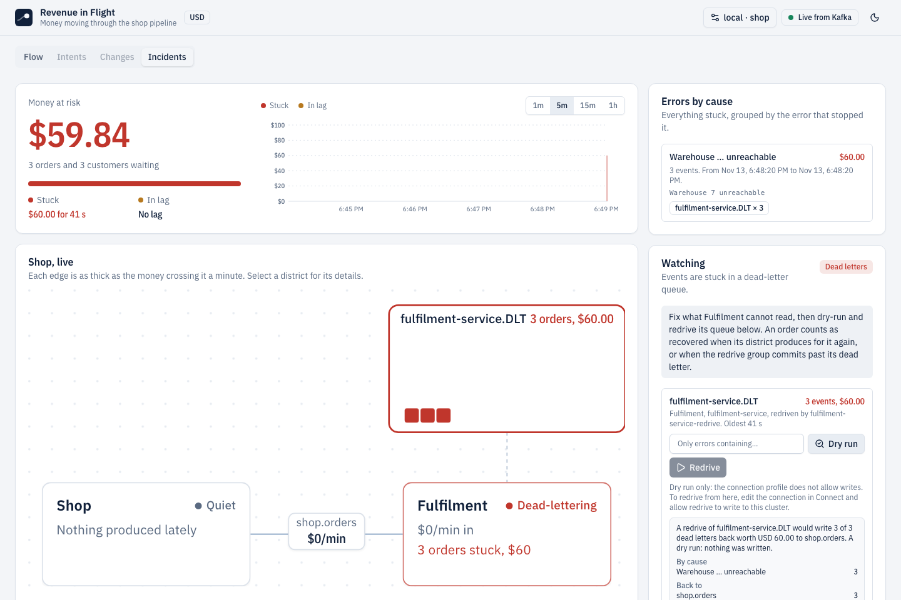
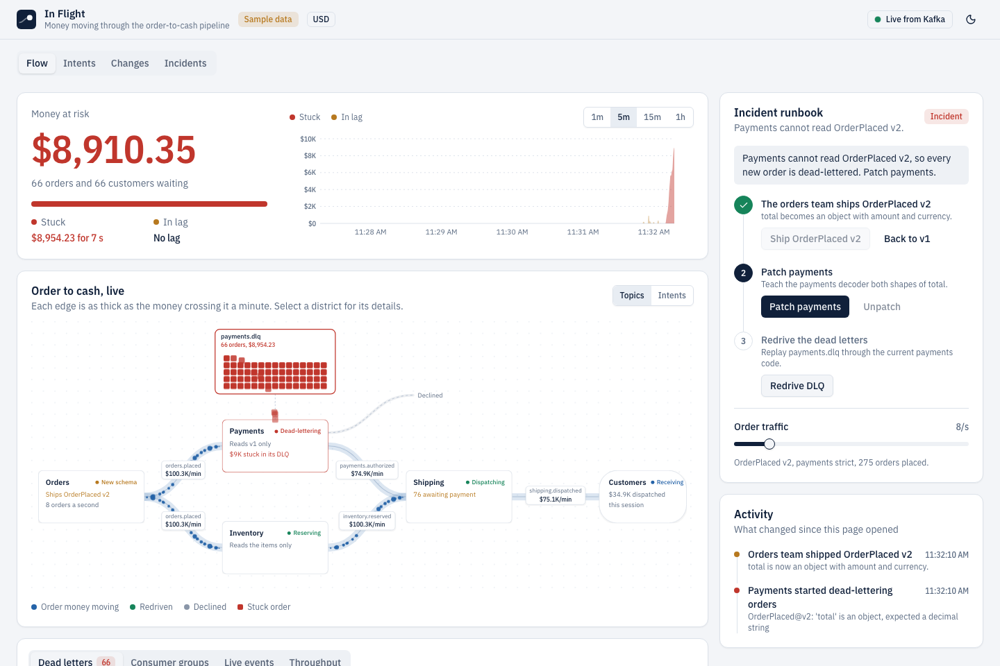
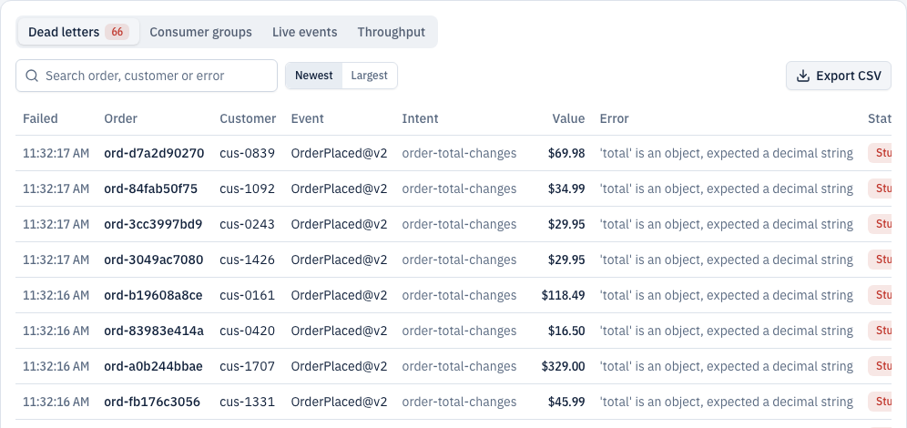
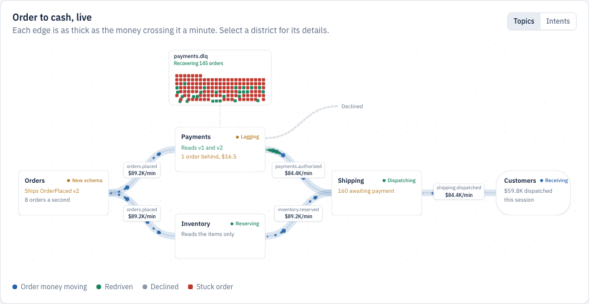
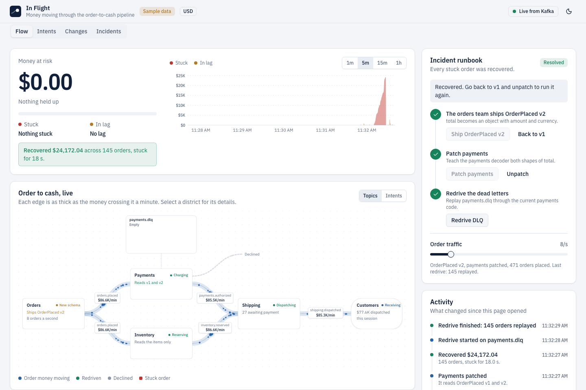
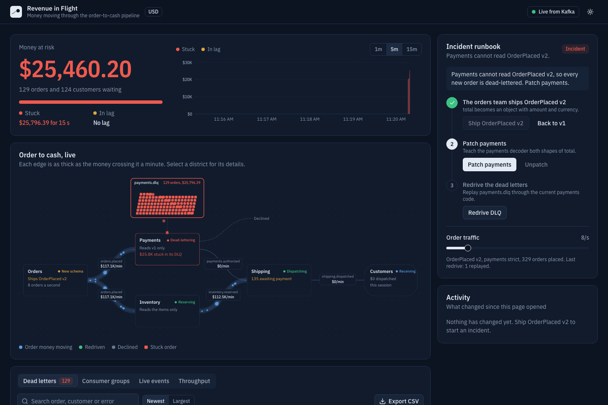

# Guide

How to watch the money moving through your own Kafka: connect, discover, confirm, watch, act. Then the sample data,
and how an incident plays out on it. Every screenshot is taken from the running app by a browser test, so they show
real Kafka data and stay current.

## Connect

```sh
revenue-in-flight                      # or: docker run --rm -p 8088:8088 -v ~/.revenue-in-flight:/home/rif/.revenue-in-flight revenue-in-flight
```

With nothing configured, the console opens on Connect.



- **Bootstrap servers** and an **auth preset**: none (a local or private cluster), ssl (TLS, add a truststore for a
  private CA), sasl-plain (Confluent Cloud: an API key as the username, its secret as the password), scram-sha-256 and
  scram-sha-512 (self-hosted, Redpanda, Aiven, MSK with SCRAM), mtls (a client certificate), msk-iam (Amazon MSK with
  IAM; needs Amazon's `aws-msk-iam-auth` library on the class path, which this build does not carry).
- **Secrets, by where they are**, never by value: `env:KAFKA_PASSWORD` (an environment variable of the app's),
  `file:/run/secrets/kafka` (a file's contents), `keychain:kafka-staging` or `keychain:kafka-staging/alice` (the macOS
  keychain: `security add-generic-password -s kafka-staging -a alice -w`). A secret typed into a form or a chat would
  be stored; a reference is safe to save and show.
- **Settings** that are not secret, such as `ssl.truststore.location`.
- **A schema registry**, for Avro and Protobuf topics: Confluent's, or Apicurio's (its base address is enough).
- **Allow redrive to write to this cluster**: off by default. Everything else only reads.

**Test** tries it without saving: the cluster's id, its brokers, how many topics, and whether the registry answers.
**Save & use** keeps it as a profile in `~/.revenue-in-flight/config.json`. Several profiles can be kept; switching
moves the running console to the other cluster without a restart.

## Discover



Everything the cluster shows, read with the admin client: each topic and how many records it holds, and whether it
looks like part of a flow, a dead-letter queue or an internal topic; each consumer group, its state, lag and what it
reads; the dead-letter queues, why each is one (its name: `.dlq`, `-dlt`, `.DLT`, `dlq-`; or Kafka Connect's,
Spring's or this tool's headers on its records), the topics its letters came from and the group that writes it.

Click a topic to see its fields: each path, its types, how often it is present, and an example with its content
masked (`ord-81723` reads `xxx-99999`) unless you choose to reveal values. Records are read without a consumer group,
so nobody's lag changes, bounded by count, bytes and time so a busy topic costs what a quiet one does.

Tick the topics of one flow, name it, and **Draft the catalog**.

## Confirm



The draft is a catalog made from the records: for each topic an event, which field is its value (and whether it is
in cents: `total_cents` is), which its order and its customer; the teams, from the topics' and groups' names; and
which group reads what and dead-letters where. Every guess has a question and how sure it is, least sure first; each
answer is one click and edits the draft. The **dry run** prices the sampled records with it: how many of each event
it prices, the range of values, and why the rest do not price. **Activate** saves it and starts watching. Whatever is
left unanswered keeps the drafter's guess.

The catalog is a plain file, `~/.revenue-in-flight/flows/<flow>.json`, to keep in a repository. **Edit JSON** on this
screen, or the file itself, is there for what the questions do not cover.

## Watch and act



The same console as the sample data's, on your flow: money at risk, stuck and in lag, by team and group; the map;
every stuck event with its customer, order and error. The **Incidents** view groups what is stuck by cause, with what
varies between records (ids, offsets, quoted values) taken out, so an incident reads as one or two rows.

- **Lag from before the console started** is valued at each topic's recent average and marked as an estimate (≈);
  only lag on events it saw is valued exactly.
- **A restart keeps** the chart, the episode in progress, the last recovery and what was already recovered
  (`~/.revenue-in-flight/state/`).
- **Topics that do not exist yet** are waited for, and read from their start when they appear.
- **Redrive**, per dead-letter queue: a dry run first, which reads and writes nothing and says how many letters would
  go back where, worth how much, by cause. A run writes each letter back to the topic it came from, as it was, with a
  `redriveof` header naming it; filtered by error text (and over MCP or the CLI by order or failure time),
  rate-limited, stoppable. It runs only on a profile that allows writes. Fix what failed first, or the letters come
  straight back.
- **Alerts**: `PUT /api/alerts` with `{"webhook": "https://hooks.slack.com/…", "threshold": 1000}` posts a line when
  money at risk crosses the threshold, and again when it falls back below it.

Bound beyond localhost (`HOST=0.0.0.0`), the console asks for a login token: `RIF_TOKEN`, or one made up and printed
at start (open the printed address once; it sets a cookie).

## Set it up by asking

```sh
claude mcp add revenue-in-flight -- revenue-in-flight mcp
```

"Connect to our staging Kafka and watch the checkout flow." The `set-up-a-flow` prompt takes an agent through
`status`, `connect`, `discover`, `sample_topic`, `draft_catalog`, `validate_catalog`, `edit_catalog` and `activate`.
Where the client supports elicitation, the draft's least sure questions are asked directly; otherwise they come back
in the result for the agent to ask. `connect` refuses a secret typed into the chat and asks for a reference instead.
The stdio server also serves the console on :8088, so what the agent sets up is on screen. The same steps from a
script: `revenue-in-flight connect`, `discover`, `sample`, `draft`, `validate`, `activate`, `redrive`.

## The catalog

```json
{
  "flow": "checkout",
  "currency": "USD",
  "rates": { "EUR": 1.08 },
  "districts": [
    { "id": "cart", "name": "Cart" },
    { "id": "billing", "name": "Billing" },
    { "id": "buyers", "name": "Buyers", "sink": true }
  ],
  "events": [
    { "type": "CartCheckedOut", "version": 1, "topic": "carts", "district": "cart",
      "value": "price_cents", "minorUnits": true, "customer": "buyer", "order": "cartId" },
    { "type": "InvoicePaid", "version": 1, "topic": "invoices", "district": "billing",
      "value": "paid", "currencyField": "currency", "customer": "buyer", "order": "cartId" }
  ],
  "consumers": [
    { "group": "billing-service", "district": "billing", "reads": ["carts"],
      "dlq": "billing.dlq", "redrive": "billing-service-redrive" },
    { "district": "buyers", "reads": ["invoices"] }
  ]
}
```

- **`minorUnits`**: the value is in the currency's minor unit (cents, pence; yen have none).
- **`currency`** on an event, or **`currencyField`** naming a field of it: an event in another currency, converted at
  the catalog's **`rates`** (what one of it is worth in the catalog's currency). With no rate, its value is unknown,
  never guessed.
- **`redrive`**: the consumer group a redrive reads the queue under; its commits are how the console knows, after a
  restart too, what was dealt with.

[`catalog/order-to-cash.json`](../catalog/order-to-cash.json) is the sample data's catalog, with the meaning layer
(entities, effects, intents) the [README](../README.md#going-further-meaning-intents-and-the-gate) describes. The map
lays itself out from the catalog: each district one column to the right of the furthest district it reads from,
sinks last.

### What it reads

- **Formats:** CloudEvents in JSON (one object, or attributes in `ce_` headers), plain JSON, JSON framed for a schema
  registry, Avro and Protobuf through a registry (Confluent's wire format; Apicurio's eight-byte global ids, in the
  frame or in headers). A Protobuf schema is parsed when it is first met: messages, nested types, enums, maps,
  oneofs and the well-known types; imports of other files of your own are not followed.
- **Event types:** an event that does not say its type and version is matched to the catalog's types for its topic,
  newest version first, the first whose value, customer and order resolve. A version the catalog does not list yet is
  priced with the newest listed version that can read it.
- **Dead letters that cannot be priced** count as stuck with their value unknown, never $0.
- **Dead-letter headers:** its own, Kafka Connect's (with `errors.deadletterqueue.context.headers.enable=true`) and
  Spring Kafka's; others by `deadLetterHeaders` in the catalog: `{ "error": "…", "failedAt": "…", "sourceTopic": "…" }`.
- **Recovery:** a stuck order counts as recovered when an event names it in `redriveof` (an attribute, or the header a
  redrive writes), when the district that dead-lettered it produces an event for the same order, or when the queue's
  redrive group commits past it.

It only reads, except a redrive you start. It never joins or commits for your consumer groups. It needs read access
to the catalog's topics and permission to describe its consumer groups; a redrive needs to write to the source topics
and commit for its own group.

### Not supported yet

- **Protobuf imports** of files other than protobuf's well-known types.
- **MSK IAM** needs Amazon's library added to the class path.
- **Very busy clusters.** One process reads every flow topic. It kept up with the sample data at 500 orders a second;
  sampling bounds discovery's cost, not the observer's.

## Try it with sample data

`revenue-in-flight try` (after `revenue-in-flight up`) runs a simulated order-to-cash business, labelled as sample
data, with controls to break it and fix it.


### The console


- **Money at risk**, top left: what is held up right now. That is money in dead-letter queues (stuck) plus money
  that consumer groups have not processed yet (lag). Each order counts once, and each customer once. Beside it is the
  history for the last 1, 5 or 15 minutes.
- **The flow map**: districts left to right in the order money moves. Each edge is as thick as the money crossing
  it a minute, and each event is a particle sized by its value. The box above Payments is its dead-letter queue.
  Select a district for its details.
- **The runbook**, on the right: where the incident stands and what to do next, with the demo's controls.
- **Activity**: what changed since the page opened.
- **Tabs** under the map: dead letters, consumer groups, the live event stream and throughput by topic.
- **Views**, above it all: Flow (this one), Intents, Changes and Incidents. The map stays in the middle of each. In
  Flow, the toggle over the map labels each edge by its topic or by the intent its reader subscribes to.

### An incident

**Ship OrderPlaced v2** in the runbook. In v2, `total` becomes `{ amount, currency }`. Payments reads `total` and
cannot parse the new shape, so it dead-letters every new order. Inventory reads only the items, so it carries on.



The counter turns red and climbs. Orders pile up as red blocks in `payments.dlq`, and the Payments edge to Shipping
thins out while Inventory's stays full. Shipping waits for payments that never come.

The **Dead letters** tab lists every stuck order with the error that stopped it. You can search it, sort it by
newest or largest, and export it as CSV.



Select a district for what it produces and reads, its consumer group, what it is holding up, and why:


### Recovery

**Patch payments** teaches it both shapes, so new orders flow again. The dead letters stay stuck until you
**Redrive DLQ**, which replays them through the patched service. Each recovered order turns green, drops back into
Payments and flies on to Shipping:



The counter drains to $0, and the headline reports what was recovered and how long it was stuck:



### Intents

**Intents** lists what each consumer reads by, in the catalog's terms: `intent.order-total-changes` is
`changes(Order.total)`, read by payments-service. Each shows its matches (the event versions, why each matches, what
a reader takes from it), whether the router is running it, its lag, and its latest events.

Type a predicate in **What would this match?** and it compiles as you type. Its matches light up on the map; a
mistake is named, such as `Order has no attribute 'paymnt' (has: total, status, payment, stock)`. Give it a name and
**Declare** it, and the router starts writing `intent.<name>` from the events that already exist.

### Shipping v2 through the catalog

This needs the whole stack: `bin/revenue-in-flight up`, then `bin/revenue-in-flight demo`.

1. **Propose the catalog's next revision** in Changes. The change says payments-service must change before v2 ships,
   or its events pile up in `payments.dlq`; inventory is reached and reads v2 the way it reads v1. Payments' regenerated
   binding is shown as a diff, on a branch. The gate refuses `OrderPlaced@v2`.
2. Switch to **Orders ship through the gate**, then **Ship OrderPlaced v2** in the runbook. The gate refuses every v2
   order, so they keep going out as v1, and nothing gets stuck.
3. **Merge the migrations**: Payments' team merges its binding and deploys it. Then **Approve**: v2 is registered, the
   router activates revision 2, and v2 flows to a Payments that can read it.

The card at the top of Changes compares the two runs: what the first one cost, and the $0 of the second.
**Incidents** says, for each kind of stuck event, which intent its reader reads by and whether the catalog had
predicted it: during the first run, the impact of `OrderPlaced@v2` had named payments-service.

## Light, dark and phone

The console follows the system's light or dark setting, and the theme button in the top bar switches it. Below
1280 px the runbook moves up under the counter, and on a phone the map scrolls sideways inside its card.

<p>
  
  
</p>

## Updating the screenshots

```sh
test/setup/seed.sh && npx playwright test -c playwright.setup.config.ts && test/setup/seed.sh down   # the setup flow
npm run docs:screenshots                                                                             # the sample data
```

The first starts a throwaway Kafka on 9392 holding a small shop that knows nothing of this tool, drives the app from
nothing to a watched flow in a browser, and writes `docs/images/setup-*.png`. The second builds the package, starts
its own simulator, sample-data console and watch console on ports 28088 to 28090, runs the incident and writes the
rest of `docs/images/`. Stop `try` first: a second simulator on the same Kafka is refused.
