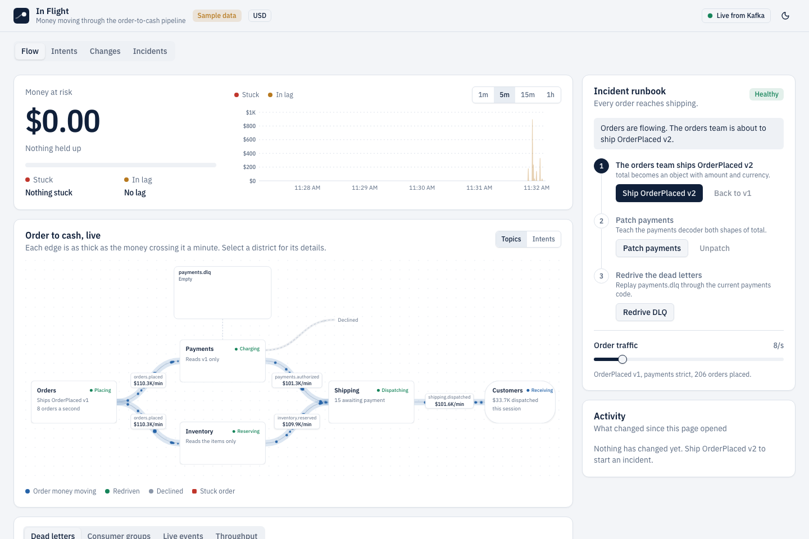
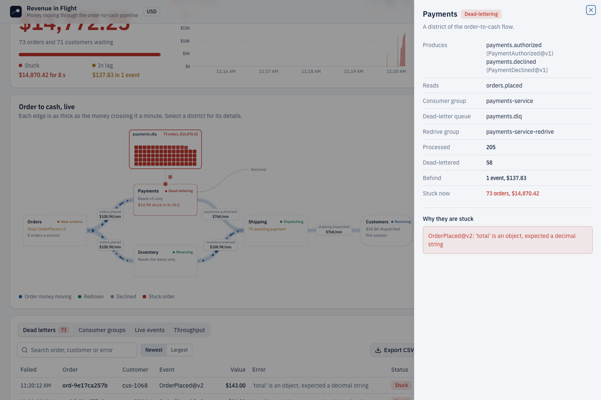
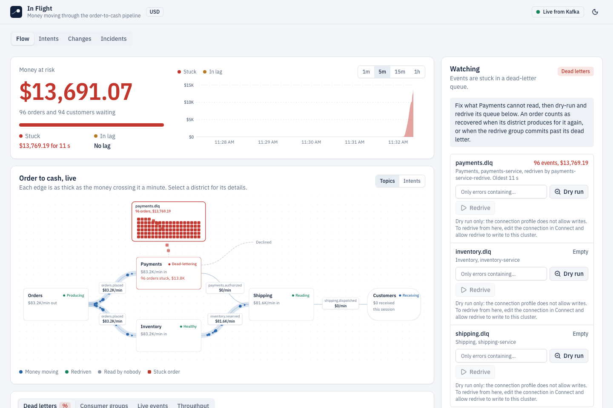
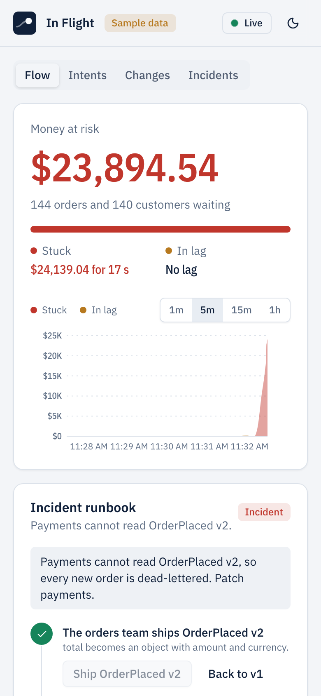

# Guide

What the console shows, how an incident plays out on it, and how to point it at your own Kafka. Every screenshot is
taken from the running demo by `npm run docs:screenshots`, so they show real Kafka data and stay current.

## The console



- **Money at risk**, top left: what is held up right now. That is money in dead-letter queues (stuck) plus money
  that consumer groups have not processed yet (lag). Each order counts once, and each customer once. Beside it is the
  history for the last 1, 5 or 15 minutes.
- **The flow map**: districts left to right in the order money moves. Each edge is as thick as the money crossing
  it a minute, and each event is a particle sized by its value. The box above Payments is its dead-letter queue.
  Select a district for its details.
- **The runbook**, on the right: where the incident stands and what to do next, with the demo's controls.
- **Activity**: what changed since the page opened.
- **Tabs** under the map: dead letters, consumer groups, the live event stream and throughput by topic.
- **Views**, above it all: Flow (this one), Intents, Changes and Incidents. The map stays in the middle of each. In
  Flow, the toggle over the map labels each edge by its topic or by the intent its reader subscribes to.

## An incident

**Ship OrderPlaced v2** in the runbook. In v2, `total` becomes `{ amount, currency }`. Payments reads `total` and
cannot parse the new shape, so it dead-letters every new order. Inventory reads only the items, so it carries on.


The counter turns red and climbs. Orders pile up as red blocks in `payments.dlq`, and the Payments edge to Shipping
thins out while Inventory's stays full. Shipping waits for payments that never come.

The **Dead letters** tab lists every stuck order with the error that stopped it. You can search it, sort it by
newest or largest, and export it as CSV.


Select a district for what it produces and reads, its consumer group, what it is holding up, and why:



## Recovery

**Patch payments** teaches it both shapes, so new orders flow again. The dead letters stay stuck until you
**Redrive DLQ**, which replays them through the patched service. Each recovered order turns green, drops back into
Payments and flies on to Shipping:


The counter drains to $0, and the headline reports what was recovered and how long it was stuck:


## Intents

**Intents** lists what each consumer reads by, in the catalog's terms: `intent.order-total-changes` is
`changes(Order.total)`, read by payments-service. Each shows its matches (the event versions, why each matches, what
a reader takes from it), whether the router is running it, its lag, and its latest events.

Type a predicate in **What would this match?** and it compiles as you type. Its matches light up on the map; a
mistake is named, such as `Order has no attribute 'paymnt' (has: total, status, payment, stock)`. Give it a name and
**Declare** it, and the router starts writing `intent.<name>` from the events that already exist.

## Shipping v2 through the catalog

This needs the whole stack: `bin/revenue-in-flight up`, then `bin/revenue-in-flight demo`.

1. **Propose the catalog's next revision** in Changes. The change says payments-service must change before v2 ships,
   or its events pile up in `payments.dlq`; inventory is reached and reads v2 the way it reads v1. Payments' regenerated
   binding is shown as a diff, on a branch. The gate refuses `OrderPlaced@v2`.
2. Switch to **Orders ship through the gate**, then **Ship OrderPlaced v2** in the runbook. The gate refuses every v2
   order, so they keep going out as v1, and nothing gets stuck.
3. **Merge the migrations**: Payments' team merges its binding and deploys it. Then **Approve**: v2 is registered, the
   router activates revision 2, and v2 flows to a Payments that can read it.

The card at the top of Changes compares the two runs: what the first one cost, and the $0 of the second.
**Incidents** says, for each kind of stuck event, which intent its reader reads by and whether the catalog had
predicted it: during the first run, the impact of `OrderPlaced@v2` had named payments-service.

## Watch your own Kafka

The console doesn't need the simulator. Describe your flow in a catalog file, then run `watch` against your Kafka.
You get the same map, money at risk and tables, with no controls.



```sh
export BOOTSTRAP_SERVERS=broker-1:9092
bin/revenue-in-flight watch my-flow.json   # then open http://localhost:8088
```

The catalog names your districts, where each event type is published, and where its value, customer and order id
sit in the event. It also names who reads what, each service's consumer group and dead-letter queue, and
optionally the consumer group that redrives each queue:

```json
{
  "flow": "checkout",
  "currency": "USD",
  "districts": [
    { "id": "cart", "name": "Cart" },
    { "id": "billing", "name": "Billing" },
    { "id": "buyers", "name": "Buyers", "sink": true }
  ],
  "events": [
    { "type": "CartCheckedOut", "version": 1, "topic": "carts", "district": "cart",
      "value": "price", "customer": "buyer", "order": "cartId" },
    { "type": "InvoicePaid", "version": 1, "topic": "invoices", "district": "billing",
      "value": "paid", "customer": "buyer", "order": "cartId" }
  ],
  "consumers": [
    { "group": "billing-service", "district": "billing", "reads": ["carts"],
      "dlq": "billing.dlq", "redrive": "billing-redrive" },
    { "district": "buyers", "reads": ["invoices"] }
  ]
}
```

[`catalog/order-to-cash.json`](../catalog/order-to-cash.json) is the demo's catalog. The map lays itself out from
the catalog. Each district sits one column to the right of the furthest district it reads from, and sinks go last.

### What it reads

- **Events:** CloudEvents in JSON, either as one JSON object or with the attributes in `ce_` headers, or plain JSON.
  JSON written by a Schema Registry serializer is read too.
- **Event types:** an event that doesn't say its type and version is matched to the catalog's types for its topic.
  It tries the newest version first and takes the first one whose value, customer and order paths all resolve.
- **Schema changes:** a version your catalog doesn't list yet is priced with the newest listed version of the same
  type that can read it.
- **Dead letters that cannot be priced:** a dead letter that no listed version can read still counts as stuck, with
  its value shown as unknown. The tool never treats it as $0.
- **Dead-letter headers:** it recognises its own headers, Kafka Connect's (with
  `errors.deadletterqueue.context.headers.enable=true`) and Spring Kafka's. Different header names can be set with
  `deadLetterHeaders` in the catalog: `{ "error": "…", "failedAt": "…", "sourceTopic": "…" }`.
- **Recovery:** a stuck order counts as recovered when one of these happens:
  - an event names it in a `redriveof` attribute;
  - the district that dead-lettered it produces an event for the same order;
  - the queue's redrive consumer group commits past it. This is the only signal for a dead letter that couldn't be
    priced.

It only reads. It never joins or commits for your consumer groups, and it reads the flow topics through
partition assignment, outside any group. It needs read access to the catalog's topics and permission to describe
its consumer groups. Every topic in the catalog must exist before it starts.

### Connecting to a secured cluster

Any Kafka Java client setting goes in an environment variable: `RIF_KAFKA_`, then the property name in capitals with
underscores for dots.

```sh
export RIF_KAFKA_SECURITY_PROTOCOL=SASL_SSL
export RIF_KAFKA_SASL_MECHANISM=PLAIN
export RIF_KAFKA_SASL_JAAS_CONFIG='org.apache.kafka.common.security.plain.PlainLoginModule required username="…" password="…";'
```

### For an agent

`SIMULATOR_URL=none RIF_CATALOG=my-flow.json bin/revenue-in-flight mcp` gives an agent the read-only tools on your
flow: `value_at_risk`, `stuck_events`, `last_episode` and the `rif://flow` resource. The control tools are left out.

### Not supported yet

- **Avro and Protobuf.** Records in these formats can't be decoded, so dead letters count as stuck with an unknown
  value, and flow events go uncounted.
- **More than one currency.** Every value is taken to be in the catalog's currency.
- **Lag value.** Lag is counted exactly from offsets, but its value covers only events the observer saw arrive since
  it started.
- **Busy topics.** One process reads every flow topic. It kept up with the demo at 500 orders a second; a much
  busier cluster would need sampling.

## Light, dark and phone

The console follows the system's light or dark setting, and the theme button in the top bar switches it. Below
1280 px the runbook moves up under the counter, and on a phone the map scrolls sideways inside its card.

<p>
  
  
</p>

## Updating the screenshots

```sh
npm run docs:screenshots
```

This builds the package and starts its own simulator, demo console and watch console on ports 28088 to 28090. It
then runs the incident and writes `docs/images/`. Stop the demo first: a second simulator on the same Kafka is
refused.
